# Flujo del proceso: de la inscripción a los 10 días del programa

Diagrama de las etapas del programa *Leer es Poderoso*, desde la preparación hasta el cierre.
Muestra dónde entra la **firma electrónica** (independiente del tipo de firma que se defina)
y cómo se respalda con la **foto del carnet**.

GitHub dibuja el diagrama directamente al abrir este archivo.

```mermaid
flowchart TB
  subgraph E0["Etapa 0 · Preparación (Superusuario y Administrador)"]
    A1["Superusuario crea la organización<br/>y habilita al administrador"]
    A2["Administrador crea la versión<br/>ej. Verano 2027"]
    A3["Confirma las zonas<br/>institución + contacto responsable"]
    A4["Define fechas por zona<br/>inicio y fin, sugerido 10 días hábiles"]
    A5["Asigna coordinadores y tutores<br/>a cada zona de la versión"]
    A1 --> A2 --> A3 --> A4 --> A5
  end

  subgraph E1["Etapa 1 · Inscripción del niño"]
    B1{"¿Cómo llega<br/>el apoderado?"}
    B2["Por su cuenta<br/>el apoderado elige organización,<br/>versión y zona"]
    B3["Con QR de un tutor<br/>el apoderado escanea el QR<br/>versión y zona ya precargadas<br/>queda registrado el tutor"]
    B4["Con ayuda del tutor<br/>opción Inscribir yo mismo<br/>el tutor abre el formulario<br/>junto al apoderado<br/>canal de ingreso: tutor"]

    subgraph DATOS["EL APODERADO INGRESA LOS DATOS DEL NIÑO · todos obligatorios"]
      N1["Nombre completo del niño"]
      N2["Fecha de nacimiento"]
      N3["Curso o nivel"]
      N4["RUN del niño<br/>se valida el dígito verificador"]
      N5["Foto del niño<br/>cámara o galería<br/>será su foto de referencia"]
      N6{"¿Todo completo<br/>y válido?"}
      N1 --> N2 --> N3 --> N4 --> N5 --> N6
      N6 -->|No, corregir| N1
    end

    B1 -->|Por su cuenta| B2
    B1 -->|QR de un tutor| B3
    B1 -->|Con el tutor| B4
    B2 --> N1
    B3 --> N1
    B4 --> N1
  end

  subgraph E2["Etapa 2 · Consentimiento y firma electrónica (apoderado)"]
    C1["Pantalla 1a · Consentimiento informado<br/>generado desde la ficha del niño"]
    C2["Pantalla 1b · Datos del tutor legal<br/>RUN, nombre, vínculo con el niño"]
    C3["Pantalla 1b · Foto del carnet<br/>frente y reverso"]
    C4{"¿Identidad<br/>verificada?"}
    C5["Pantalla 1c · FIRMA ELECTRÓNICA<br/>trazo + declaración aceptada<br/>tipo de firma por definir"]
    C6["Evidencia que respalda la firma<br/>RUN, resultado de la verificación<br/>del carnet, hash del documento,<br/>fecha y hora"]
    C7["Pantalla 1d · Consentimiento firmado<br/>copia por correo al apoderado"]
    C1 --> C2 --> C3 --> C4
    C4 -->|Sí| C5
    C4 -->|No| C3
    C5 --> C6 --> C7
    C3 -.->|respaldo de identidad| C6
  end

  subgraph E3["Etapa 3 · Ejecución de los 10 días hábiles"]
    H1{"¿Consentimiento<br/>vigente?"}
    H0["No se inscribe al niño<br/>hasta contar con consentimiento"]
    H2["Niño inscrito en la zona<br/>y versión"]
    C8{"¿El apoderado inscribe<br/>otro hijo o hija?"}
    F1["Día N del programa"]
    F2["Tutor toma la foto del grupo"]
    F3["Detección de rostros y reconocimiento<br/>con las fotos de referencia"]
    F4["Revisión humana del tutor<br/>corrige y asigna rostros sin identificar<br/>presentes no superan los rostros detectados"]
    F5["Confirma la asistencia<br/>queda registrado quién y cuándo"]
    F6{"¿Fue el<br/>día 10?"}
    F7["Monitoreo acumulado<br/>coordinador y administrador<br/>exportación CSV"]
    H1 -->|Sí| H2
    H1 -->|No| H0
    H2 --> C8
    C8 -->|No| F1
    F1 --> F2 --> F3 --> F4 --> F5 --> F6
    F6 -->|No| F1
    F5 -.-> F7
  end

  subgraph E4["Etapa 4 · Cierre"]
    G1["Termina la fecha de fin de la zona"]
    G2["Un mes después se elimina<br/>la foto grupal"]
    G3["Se conservan los registros de<br/>asistencia y el consentimiento"]
    G1 --> G2 --> G3
  end

  A5 --> B1
  N6 -->|Sí| C1
  C7 --> H1
  C8 -->|Sí, otro niño| B1
  H0 -.->|obtener consentimiento| C1
  F6 -->|Sí| G1

  L1["Inscripción tardía durante el programa<br/>repite las etapas 1 y 2<br/>aparece como no enrolado en los días previos"]
  F1 -.-> L1
  L1 -.-> B1

  R1["Revocación del consentimiento<br/>en cualquier momento"]
  R2["El niño sale de la inscripción<br/>se borra su foto de referencia<br/>la asistencia ya confirmada se conserva"]
  R1 --> R2

  classDef datos fill:#E7F4F5,stroke:#2F8F99,stroke-width:3px,color:#15343A
  classDef firma fill:#EFE8FB,stroke:#7A4AC2,stroke-width:3px,color:#3B2470
  classDef evidencia fill:#F4F3F0,stroke:#2F8F99,stroke-width:2px,color:#15343A
  classDef aviso fill:#FDEEDC,stroke:#8A5A12,color:#5A3A0C
  class N1,N2,N3,N4,N5,N6 datos
  class C5 firma
  class C3,C6 evidencia
  class H0,L1,R1,R2 aviso
```

## Relación con las pantallas del Figma

| Paso del flujo | Pantalla del Figma | En la app |
|---|---|---|
| Elegir organización, versión y zona | No existe en el Figma | `app/onboarding/index.tsx` |
| Datos del niño (nombre, nacimiento, curso, RUN) | No existe en el Figma: la ficha del alumno se asumía ya creada | `app/onboarding/nino.tsx` |
| Foto del niño | No existe en el Figma (la foto de referencia se tomaba al inscribir por QR, pantalla 2) | `app/onboarding/foto.tsx` |
| Consentimiento informado | 1a | `app/onboarding/1a.tsx` |
| Datos del tutor legal y carnet | 1b | `app/onboarding/1b.tsx` |
| Firma | 1c | `app/onboarding/1c.tsx` |
| Consentimiento firmado | 1d | `app/onboarding/1d.tsx` |
| Foto del grupo | 3 | `app/asistencia/foto.tsx` |
| Revisión y confirmación | 4 | `app/asistencia/revision.tsx` |

## Decisiones pendientes que afectan este flujo

- **Tipo de firma electrónica:** simple (la actual) o avanzada con proveedor acreditado (Ley 19.799).
- **Foto del carnet:** el Figma indica que no se guardan las imágenes de la cédula, solo el RUN y el resultado
  de la verificación. Si la imagen debe respaldar la firma como evidencia, hay que guardarla cifrada, definir
  su plazo de conservación y cambiar el texto del consentimiento.
- **Texto de conservación en el Figma (1a):** dice que la foto se elimina al confirmar la asistencia. La app
  conserva la foto grupal hasta un mes después del fin de la zona. Conviene alinear el Figma con la regla vigente.
- **Verificación de identidad:** hoy la app solo valida el formato del RUN y simula la foto del carnet.
